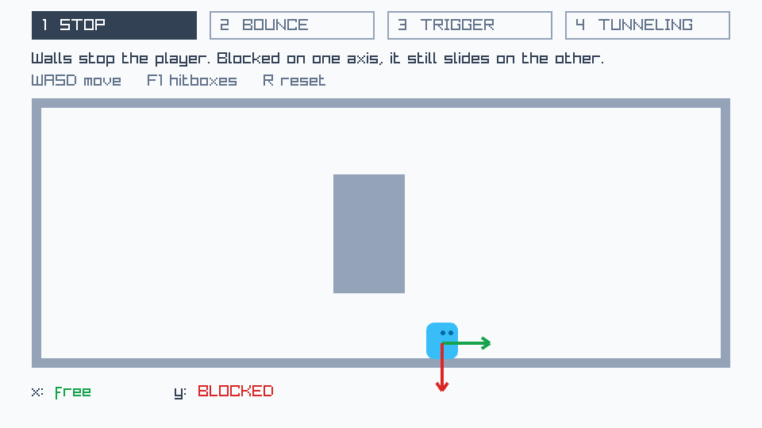
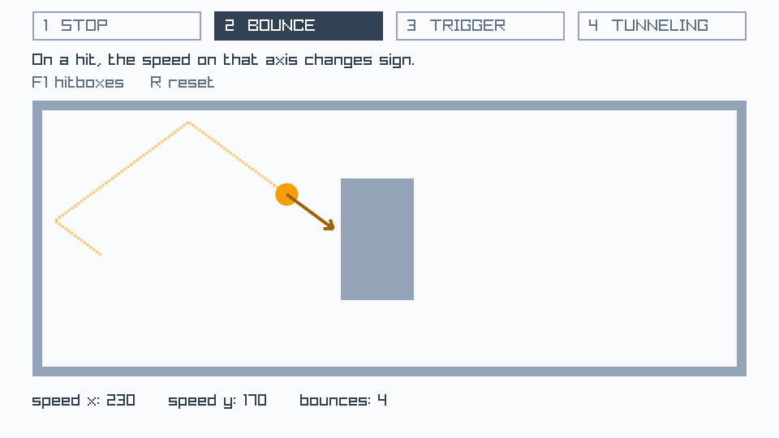
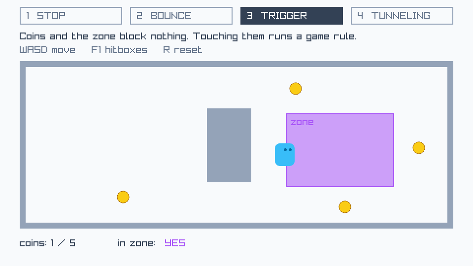
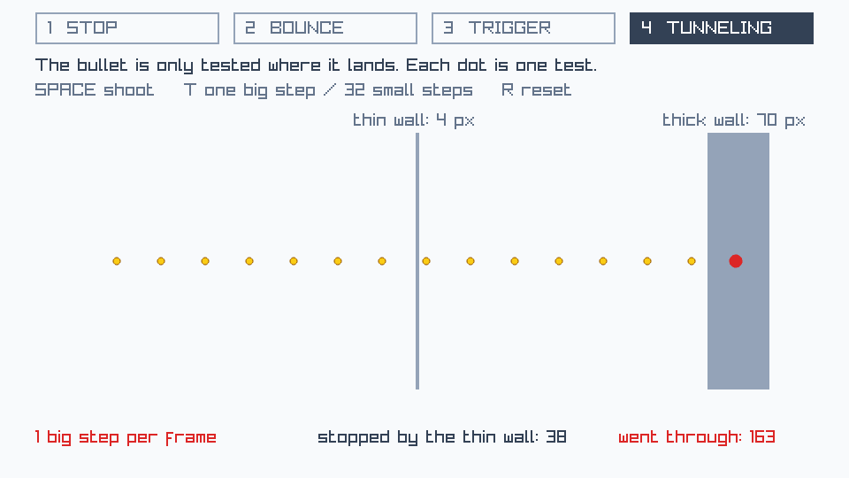

# collision — Chapter 9 demo

A single-file Odin + raylib program with **four small scenes, one idea each**.
All the code on the Chapter 9 slides comes from this file.

## Run

```sh
odin run source/collision          # from the repository root
```

## The four scenes

Press `1`-`4` to switch. Each scene has a title, one sentence saying what to
look at, and a status line at the bottom that changes as it happens.

| Key | Scene | What to do | What to watch | Code |
|---|---|---|---|---|
| `1` | **STOP** | walk into a wall with `WASD`, then push diagonally | one arrow per axis: green = free, red = blocked. Blocked on x, the player still slides on y | `move_player` |
| `2` | **BOUNCE** | nothing, just watch | the dotted path, and `speed x` / `speed y` changing sign on each hit | `move_ball` |
| `3` | **TRIGGER** | walk over the coins and into the zone | the coin count and `in zone` change; nothing ever blocks you | `collect_coins`, `draw_trigger` |
| `4` | **TUNNELING** | `SPACE` to shoot, then `T` and shoot again | each dot is one place the bullet was tested. With one big step the dots straddle the thin wall; with 32 small steps one of them lands on it | `move_bullet` |

Other keys: `F1` shows the hitboxes, `R` resets the scene.

| 1 Stop | 2 Bounce |
|---|---|
|  |  |
| **3 Trigger** | **4 Tunneling** |
|  |  |

## The two ideas to hold on to

Collision is two separate questions:

| | Question | Answer | Who writes it |
|---|---|---|---|
| **Detection** | did these two shapes touch? | yes or no | raylib (`rl.CheckCollision...`) |
| **Response** | what happens because they did? | stop, bounce, or trigger | you |

And there are only three responses in this file:

- **Stop**: the move is undone. Nothing passes through.
- **Bounce**: the move is undone and the speed changes sign.
- **Trigger**: nothing is blocked. A game rule runs (score + 1, "you are in the zone").

## How the file is laid out

`collision.odin` is about 450 lines, but **only the top half is collision**.
Stop reading at the line that says `Everything below only DRAWS and EXPLAINS`.
The bottom half is tabs, arrows, dots and text.

The top half has five parts, marked `[1]` to `[5]` in the comments:

| Part | What it is | Look at |
|---|---|---|
| `[1]` | **The data.** A hitbox is a plain shape | `Player`, `Ball`, `Coin`, `Bullet` |
| `[2]` | **Static things.** The walls are lists of rectangles | `room`, `lane`, `walls`, `zone` |
| `[3]` | **Detection.** One moving thing against every wall | `box_hits_wall`, `circle_hits_wall` |
| `[4]` | **Response.** One procedure per scene | `move_player`, `move_ball`, `collect_coins`, `move_bullet` |
| `[5]` | **Who tests whom.** One `case` per scene | `update` |

## Study guide

Work through this with the program running next to the code. For each
question, find the line that answers it.

### Read

1. **`[1]`** What two things does the game know about the player? Which one is the hitbox?
2. **`[1]`** A `Ball` has no `rl.Rectangle`. What is its hitbox made of?
3. **`[2]`** Does any line in the top half ever change `room` after the program starts? What does that tell you about walls?
4. **`[2]`** The `zone` is a rectangle, like a wall. Why is it not inside `room`?
5. **`[3]`** `box_hits_wall` returns a `bool`. What does it *not* tell you about the hit?
6. **`[4]`** In `move_player`, which line is detection and which is response?
7. **`[4]`** `move_ball` looks almost the same as `move_player`. Which one line makes it a bounce?
8. **`[4]`** When a coin is touched, `collect_coins` changes two things. What are they? Does any position change?
9. **`[4]`** In `move_bullet`, how far does the bullet jump in one go when `steps` is 1? When it is 32?
10. **`[5]`** In scene 3, coins are never tested against walls. Where in `update` can you see that?

### Predict, then change one line

Write down what you think will happen **before** you run it. Change one thing
at a time and undo it afterwards.

| # | Change | Scene |
|---|---|---|
| A | `BOUNCE :: 0.8` | 2 |
| B | In `move_player`, do both moves first, then one test that undoes both (see below) | 1, push diagonally into a wall |
| C | Make the thin wall 60 pixels wide: `{470, 150, 60, 290}` | 4, with `T` off |
| D | In `update`, replace the `32` in `small_steps ? 32 : 1` with `2`, then `4`, then `8`. What is the smallest number that never lets a bullet through? Why that number? | 4, with `T` on |
| E | `PLAYER_SPEED :: 3000` | 1. What happens at the walls, and why? |
| F | Add a sixth wall to `room` | 1 and 2. Did you have to change any other code? |

Change B, written out:

```odin
move_player :: proc(move: rl.Vector2) {
	player.box.x += move.x
	player.box.y += move.y
	if box_hits_wall(player.box) {
		player.box.x -= move.x
		player.box.y -= move.y
	}
}
```

### Take it into your own game

- Which of your objects are **static** and which are **dynamic**?
- For each thing the player can touch: **stop**, **bounce**, or **trigger**?
- Which of your objects is fast enough to **tunnel**?
- Add an `F1` key that draws every hitbox, before you write any collision code.
